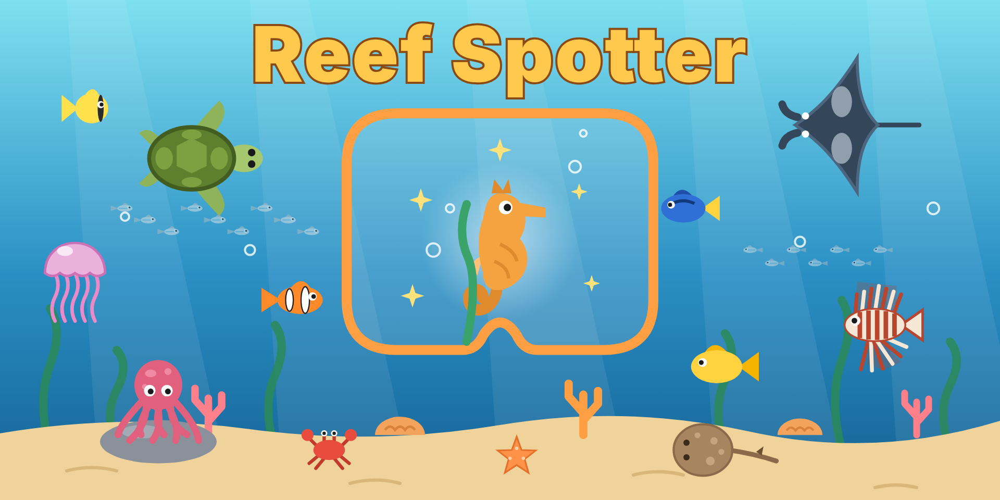

# Reef Spotter

A quick hidden-animal hunt under the sea, for families and players aged 8 and up, taking turns on one screen.

## Play it

https://carly-lynch-41.github.io/reef-spotter/

You need a phone or a computer. 1 to 4 players take turns on the same screen.

## How to play

1. Choose how many divers are playing and tap Start.
2. Look at the animal you need to find. Some are rare, some are dangerous. Tap "Dive in!" to start the clock.
3. Find that animal in the scene and tap it. It may be hiding or blending in, and look-alikes are everywhere.
4. A wrong tap does not cost points, but the clock keeps running. After each find, you learn one safety or fun fact.
5. Each diver does 5 dives, then passes the screen to the next player.
6. The lowest total time wins.

## Play test log

| Round | Who played | Where they got stuck | What I changed |
|-------|------------|----------------------|----------------|
| 1 | me | Nowhere. It worked, but it was too easy. | Animals now blend in with their surroundings, look-alike creatures and a "trap" animal were added, and later dives have more fish, smaller animals and murkier water. Made for ages 12 and up. |
| 2 |  |  |  |

## Made with

Built with Claude in Vibe Coding for Nonprofits, a Whole Whale × Meet the Moment accelerator.
